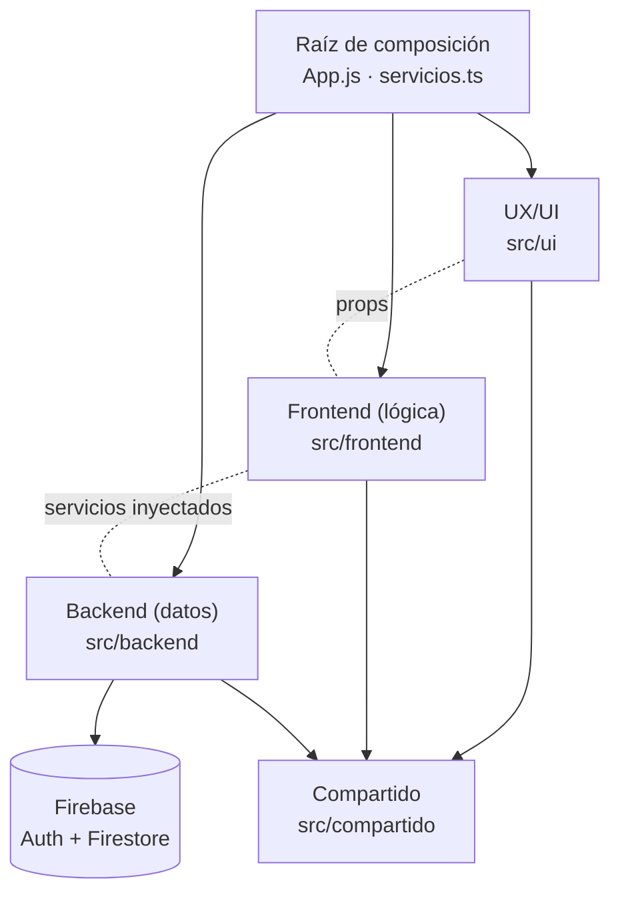

<div align="center">


# Pilares de Esperanza

**Ecosistema de salud domiciliaria: app móvil para pacientes y portal web para el personal administrativo.**


[📱 **Descargar la app (APK)**](../../releases/latest) &nbsp;·&nbsp; [🖥️ **Portal web**](https://app-dev-pilares.web.app) &nbsp;·&nbsp; [📚 **Documentación**](#documentación)

</div>

---

## ¿Qué es?

**Pilares de Esperanza** es un centro de rehabilitación con atención domiciliaria. Este repositorio contiene las dos aplicaciones que comparten un único backend en Firebase:

| Aplicación | Público | Carpeta | Qué hace |
| --- | --- | --- | --- |
| 📱 **App móvil** | Pacientes | raíz del repositorio | Registro con **verificación de correo obligatoria** (retomable si se interrumpe), sesión que se conserva al cerrar la app, captura de DNI y rostro, ubicación con mapa y control de cobertura, reserva y cancelación de turnos, **solicitud del Certificado Único de Discapacidad (CUD) con seguimiento del estado**, **notificaciones** (recordatorio de turno 3 horas antes y avisos de la solicitud), perfil y soporte. |
| 🖥️ **Portal web** | Personal administrativo | [`AppWEB-claude/`](AppWEB-claude) | Acceso solo para administradores, agenda en tiempo real, alta / cambio de estado / liberación de turnos, padrón de pacientes y **solicitudes de CUD en la ficha de cada paciente, con cambio de estado** (pendiente / aprobada con fecha y hora de la Junta Evaluadora / rechazada). Instalable como aplicación (PWA). |

### Puntos clave

- **Sin doble reserva:** cada turno tiene un ID determinístico (`profesional_especialidad_día_hora`) y se crea junto con un documento público de ocupación (`ocupados`) en una operación atómica.
- **Privacidad:** los turnos con datos personales solo los lee su dueño y la administración; los demás pacientes ven únicamente qué horarios están ocupados.
- **Solicitud de CUD:** el paciente la envía con confirmación a la colección `solicitudCUD` (una por paciente, estado "pendiente"); la administración la aprueba o rechaza desde el portal en tiempo real y el paciente ve el cambio en la app y recibe una notificación.
- **Seguridad por roles (RBAC):** reglas de Firestore versionadas en [`firestore.rules`](firestore.rules) y probadas con el emulador (45 pruebas).
- **Mapa sin claves:** la ubicación se dibuja con teselas de OpenStreetMap, sin clave de API ni módulo nativo.
- **Diseño propio:** paleta verde y lima compartida entre la app y el portal.

## Probar la app

<table>
<tr>
<td width="180" align="center"><br/><sub>Escanear con la cámara</sub></td>
<td>

1. Descargue el APK desde la [última versión publicada](../../releases/latest) (o escanee el código QR, que lleva a la página de descarga).
2. Instálelo en un teléfono **Android** (si lo solicita, permita la instalación desde esta fuente).
3. Toque **Regístrese aquí**, verifique su correo con el enlace recibido y complete el registro.

La versión para iPhone requiere cuenta de Apple Developer y todavía no está disponible.

</td>
</tr>
</table>

## Arquitectura

El código se divide en **bloques independientes** que solo se conectan en la raíz de composición. La regla de oro es **bajo acoplamiento, alta cohesión**: el frontend nunca se mezcla con el backend.



| Bloque | Responsabilidad | Puede importar |
| --- | --- | --- |
| `backend/` | Autenticación y Firestore. Único bloque que conoce Firebase. | `compartido`, `firebase` |
| `frontend/` | Navegación, validaciones y casos de uso. No dibuja ni conoce la base de datos. | `compartido` |
| `ui/` | Pantallas, componentes y tema. Recibe todo por props. | `compartido`, librerías de UI |
| `compartido/` | Catálogo clínico y reglas puras. | nada |

> **¿Cambia la base de datos?** Solo se reemplaza `src/backend/` respetando el contrato de [`src/backend/index.js`](src/backend/index.js). `frontend/` y `ui/` no se tocan.

La regla se comprueba automáticamente sobre los imports reales:

```bash
npm run verify:arch
```

### Estructura del repositorio

```text
.
├── App.js                      # Raíz de composición (conecta backend + frontend + ui)
├── src/
│   ├── backend/                # DATOS: Firebase (FirebaseConfig, PacienteService, TurnosService, SolicitudCudService)
│   ├── frontend/               # LÓGICA: useAppController, GPS, notificaciones, borrador de registro
│   ├── ui/                     # INTERFAZ: pantallas, componentes, tema, cámara, mapa, diálogos
│   └── compartido/             # Catálogo clínico y reglas puras
├── AppWEB-claude/              # Portal web administrativo (misma separación en bloques)
├── functions/                  # Cloud Function de notificaciones push (backend)
├── firestore.rules             # Reglas de seguridad (RBAC)
├── firebase.json               # Hosting, reglas y emuladores
├── eas.json                    # Perfiles de compilación del APK
├── tests/                      # Pruebas de reglas (emulador), recordatorios y mapa
├── scripts/                    # Verificador de arquitectura, publicación del portal, QR
├── assets/                     # Logo, fondo e iconos
└── docs/                       # SDD, requerimientos, pruebas, trazabilidad, comercial y uso de IA
```

## Puesta en marcha

### Requisitos

- [Node.js](https://nodejs.org) 20 o superior y npm.
- App **Expo Go** en el teléfono (misma red Wi-Fi que la computadora) o el APK de la última versión.
- Un proyecto de Firebase con *Authentication* (correo/contraseña) y *Cloud Firestore*.
- Java 11+ (solo para las pruebas de reglas con el emulador).

### 1. App móvil

```bash
npm install
cp .env.example .env      # en Windows: copy .env.example .env  — y completar los valores EXPO_PUBLIC_FIREBASE_*
npx expo start -c
```

Escanear el código QR con Expo Go.

### 2. Portal web

```bash
cd AppWEB-claude
npm install
cp .env.example .env.local   # en Windows: copy .env.example .env.local — y completar los valores VITE_FIREBASE_*
npm run dev
```

### 3. Crear el primer administrador

1. En Firebase Console → *Authentication*, crear un usuario con correo y contraseña y copiar su **UID**.
2. En *Firestore Database*, crear la colección `administradores` con un documento cuyo **ID sea ese UID** y el campo `rol` = `admin`.
3. Publicar las reglas: `npx firebase-tools deploy --only firestore:rules`.

### Variables de entorno

| Proyecto | Archivo | Variables |
| --- | --- | --- |
| App móvil | `.env` | `EXPO_PUBLIC_FIREBASE_API_KEY`, `..._AUTH_DOMAIN`, `..._PROJECT_ID`, `..._STORAGE_BUCKET`, `..._MESSAGING_SENDER_ID`, `..._APP_ID` |
| Portal web | `AppWEB-claude/.env.local` | `VITE_FIREBASE_API_KEY`, `..._AUTH_DOMAIN`, `..._PROJECT_ID`, `..._STORAGE_BUCKET`, `..._MESSAGING_SENDER_ID`, `..._APP_ID` |

> ⚠️ Los archivos `.env*` **no se versionan** (solo `.env.example`). Tampoco las claves de firmado del APK (`credentials/`, `*.jks`). Nunca los subas a GitHub.

## Pruebas y calidad

| Comando | Qué verifica |
| --- | --- |
| `npm run verify:arch` | Que ningún bloque importe a otro de forma prohibida (app y portal). |
| `npm run test:logica` | Las reglas puras de recordatorios, textos de notificación y cálculo del mapa (26 pruebas). |
| `npm run test:rules` | Las reglas de Firestore (RBAC, doble reserva, ocupación pública) contra el emulador (45 pruebas). |
| `npm test` | Los tres anteriores. |
| `cd AppWEB-claude && npm run build` | Compilación y chequeo de tipos del portal. |

Además hay 109 casos de prueba documentados (manuales y automáticos) trazados contra los requerimientos: ver [Casos de prueba](docs/2-pruebas-y-trazabilidad/CASOS_DE_PRUEBA.md).

## Notificaciones

| Aviso | Funciona en Expo Go | Cómo |
| --- | --- | --- |
| Recordatorio de turno 3 horas antes | Sí | Notificación local semanal (`expo-notifications`). |
| Recordatorio 3 horas antes de la Junta Evaluadora del CUD | Sí | Notificación local por fecha. |
| Aviso de solicitud aprobada / rechazada con la app abierta | Sí | Notificación local al recibir el cambio en tiempo real. |
| Aviso de solicitud aprobada / rechazada con la app **cerrada** | **No** | Push remoto: Cloud Function de [`functions/`](functions); requiere el plan Blaze de Firebase y todavía **no está desplegada**. |

## Despliegue y distribución

| Qué | Cómo | Detalle |
| --- | --- | --- |
| Publicar el portal (Firebase Hosting) | `npm run desplegar:web` | Compila el portal, coloca en la página de descarga el enlace del APK y lo sube. La clínica entra por una dirección web, sin servidor propio. |
| Acceso automático en la PC de la clínica | `scripts/instalar-acceso-clinica.ps1` | Crea el icono del Escritorio y el arranque automático de Windows; no hace falta Node ni `cmd`. |
| Código QR de descarga de la app | `npm run qr` | Genera `docs/3-comercial/qr/qr-descarga.png` y `.svg` apuntando a la página `/descargar/` del portal. |
| Compilar el APK de Android | `npx eas-cli build --platform android --profile preview` | Configuración en `eas.json`; las variables `EXPO_PUBLIC_FIREBASE_*` se cargan en EAS. |

El APK se aloja en las [versiones (Releases)](../../releases) de este repositorio: Firebase Hosting en el plan gratuito rechaza archivos ejecutables.
## Documentación

| Documento | Contenido |
| --- | --- |
| [SDD](docs/1-diseno-y-requerimientos/SDD.md) | Diseño de software: arquitectura, modelo de datos, reglas RBAC y flujos críticos. |
| [Requerimientos](docs/1-diseno-y-requerimientos/REQUERIMIENTOS.md) | Requerimientos funcionales y no funcionales con criterios de aceptación. |
| [Casos de prueba](docs/2-pruebas-y-trazabilidad/CASOS_DE_PRUEBA.md) | Estrategia de pruebas y casos `TC-001` a `TC-109`. |
| [Matriz de trazabilidad](docs/2-pruebas-y-trazabilidad/MATRIZ_DE_TRAZABILIDAD.md) | Requerimiento ↔ caso de prueba, en ambos sentidos. |
| [Tarifa mensual](docs/3-comercial/TARIFA_MENSUAL.md) | Propuesta de mantenimiento mensual en USD: mano de obra del equipo e infraestructura por escala. |
| [Uso de IA](docs/IA/Declaracion_Uso_IA.docx) | Declaración y registro del uso de inteligencia artificial en el proyecto. |

## Equipo

Proyecto Integrador de Aplicaciones Móviles (2.º año). Cada integrante es dueño de un bloque y sus commits solo tocan los archivos de ese bloque.

| Integrante | Rol | Bloque |
| --- | --- | --- |
| Matías Oviedo | Dev 1 | Backend (datos, reglas de seguridad y despliegue) |
| Facundo Sberna | Dev 2 | Frontend (lógica de aplicación) |
| Victoria Rojas | Dev 3 | UX/UI (interfaz) |

## Uso de inteligencia artificial

Durante el desarrollo se utilizaron asistentes de IA como apoyo metodológico y técnico. El detalle de herramientas, finalidades y prompts clave está en la [declaración de uso de IA](docs/IA/Declaracion_Uso_IA.docx). El equipo es responsable de comprender, validar y defender todo el código y la documentación entregados.
