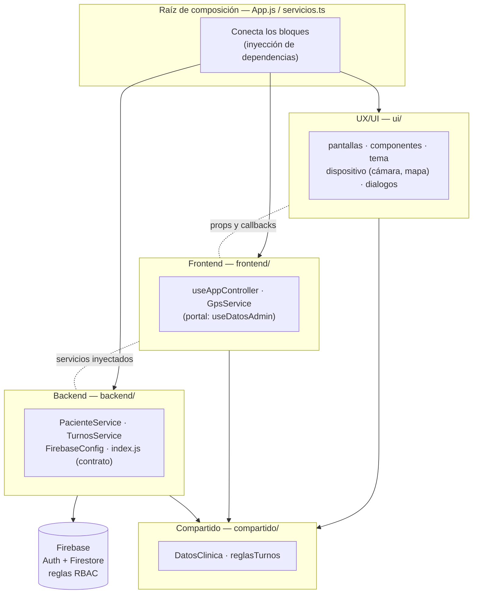
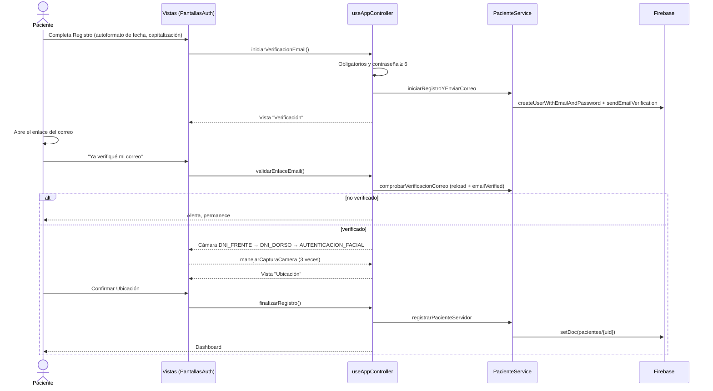
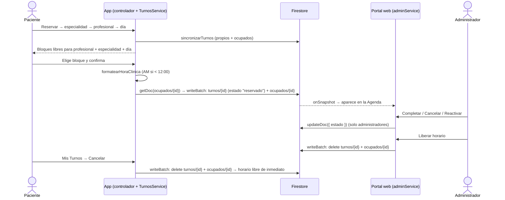
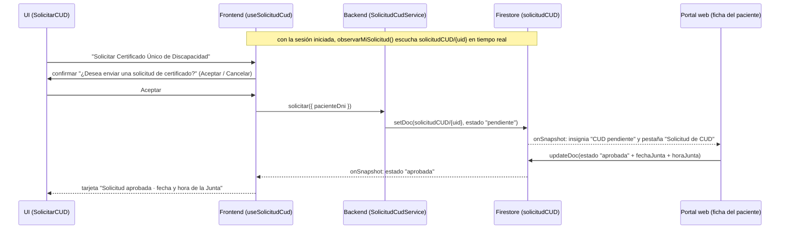

# Documento de Diseño de Software (SDD) — Pilares de Esperanza

> Describe el sistema **tal como está implementado** en el repositorio. Las limitaciones reales se señalan como *Observación*. Requerimientos formales: [REQUERIMIENTOS.md](REQUERIMIENTOS.md) · Casos de prueba y trazabilidad: [CASOS_DE_PRUEBA.md](../2-pruebas-y-trazabilidad/CASOS_DE_PRUEBA.md) y [MATRIZ_DE_TRAZABILIDAD.md](../2-pruebas-y-trazabilidad/MATRIZ_DE_TRAZABILIDAD.md).

## 1. Visión general y stack tecnológico

**Pilares de Esperanza** es un ecosistema de salud domiciliaria con dos aplicaciones sobre un único backend Firebase (proyecto `App-Dev-Pilares`):

| Aplicación | Público | Ubicación | Función |
| --- | --- | --- | --- |
| App móvil | Pacientes (B2C) | Raíz del repositorio | Registro verificado, reserva y cancelación de turnos, perfil, soporte. |
| Portal web | Personal administrativo (B2B) | `AppWEB-claude/` | Agenda en tiempo real, alta / estado / liberación de turnos, padrón y GPS de pacientes. |

| Capa | Tecnología (versión del `package.json`) |
| --- | --- |
| App móvil | React Native 0.88.1, React 19.3.0, Expo SDK 58 (`expo ~58.0.25`) |
| Cámara | `expo-camera ~58.0.14` |
| Ubicación y mapas | `expo-location ~58.0.22`; el mapa se dibuja con teselas de OpenStreetMap mediante componentes de React Native (sin `react-native-maps` ni clave de API) |
| Almacenamiento local | `@react-native-async-storage/async-storage 2.2.0` (sesión de Firebase Auth y borrador del registro, sin contraseña) |
| Interfaz móvil | `expo-linear-gradient`, `@expo/vector-icons`, `react-native-safe-area-context` (sistema de diseño propio en `Tema.js` y `ComponentesUI.js`) |
| Portal web | React ^19, Vite ^8, TypeScript ^5.7, Tailwind CSS ^4 (con CSS propio de Figma) |
| Backend | Firebase Authentication y Cloud Firestore (`firebase ^13.3.0` en ambos proyectos) |

## 2. Arquitectura en bloques (alta cohesión, bajo acoplamiento)

**Regla de oro:** cada bloque tiene una sola responsabilidad y solo conoce a los demás a través de contratos (props, funciones inyectadas o el puerto `servicios`). **El frontend no se mezcla con el backend bajo ninguna circunstancia:** ningún archivo de interfaz o de lógica de aplicación importa Firebase, y ningún archivo de datos importa React Native. La regla se verifica automáticamente con `npm run verify:arch` (TC-078 y TC-079).

### 2.1 Bloques y responsabilidades

| Bloque | App móvil (`src/`) | Portal web (`AppWEB-claude/src/`) | Responsabilidad | Puede importar |
| --- | --- | --- | --- | --- |
| **Backend** (datos) | `backend/` (`firebase/FirebaseConfig`, `PacienteService`, `TurnosService`, `SolicitudCudService`, `index.js`) y `functions/` (Cloud Functions) | `backend/` (`firebaseConfig`, `adminService`) | **Únicos** módulos que importan `firebase/*`. Autenticación, Firestore y reglas de persistencia. | `compartido`, `firebase/*` |
| **Frontend** (lógica de aplicación) | `frontend/` (`useAppController`, `useSolicitudCud`, `dispositivo/GpsService`, `dispositivo/NotificacionesService`) | `frontend/useDatosAdmin.ts` + puerto `servicios.ts` | Navegación, validaciones, casos de uso, estado de sesión y datos. No dibuja nada ni conoce la base de datos. | `compartido`, `react`, `expo-location` (solo GPS) |
| **UX/UI** (interfaz) | `ui/` (`tema`, `componentes`, `pantallas`, `dispositivo` [cámara y mapa], `dialogos`) | `ui/` (`App.tsx`, `LoginAdmin.tsx`) | Renderizado y estilos. Recibe datos y callbacks por props. | `compartido`, librerías de UI (`react-native`, `expo-camera`, …) |
| **Compartido** | `compartido/` (`DatosClinica`, `reglasTurnos`) | `compartido/` (`catalogoClinica`, `reglasTurnos`) | Catálogo clínico y reglas puras sin dependencias externas. | nada |
| **Raíz de composición** | `App.js` (fuera de `src/`) | `servicios.ts` y `main.tsx` | Único lugar donde se conectan los bloques (inyección de dependencias). | los tres bloques |



Las líneas punteadas son contratos, no imports: la UI recibe de `useAppController` los datos y las funciones por props, y el controlador recibe `servicios` y `dialogos` como argumentos. Por eso el controlador es independiente de Firebase y de `Alert` de React Native.

### 2.2 Contratos entre bloques

- **Backend → Frontend:** el objeto `servicios` exportado por `src/backend/index.js` (`servicios.paciente` y `servicios.turnos`). El contrato de cada método (parámetros, retorno y el código de error `EMAIL_NO_VERIFICADO`) está documentado en ese archivo. Cambiar de base de datos implica reemplazar el contenido de `src/backend/` respetando el contrato; `src/frontend/` y `src/ui/` no se modifican.
- **Frontend → UX/UI:** el objeto que devuelve `useAppController` (estado y acciones). `ui/` lo recibe por props desde `App.js`; `ubicacion` (`{cargando, error, region, distanciaKm}`) es un ejemplo: el GPS se lee y valida en `frontend/`, y `ui/dispositivo/MapaReal.js` solo lo dibuja.
- **UX/UI → Frontend (efectos de pantalla):** `dialogos` (`aviso`, `confirmarDestructivo`) implementado en `src/ui/dialogos/Dialogos.js` e inyectado en el controlador.
- **Portal web:** `ui/` y `frontend/` consumen el backend solo a través de `src/servicios.ts`; si cambia la base de datos solo se ajustan los `export ... from "./backend/..."` de ese archivo.

### 2.3 Verificación automática

`scripts/verificar-arquitectura.mjs` (comando `npm run verify:arch`) recorre todos los `import` / `export ... from` / `require` de la app y del portal, determina el bloque de origen y de destino de cada archivo y falla con código 1 si encuentra una dependencia prohibida (por ejemplo `ui → backend`, `frontend → firebase`, `backend → react-native`). Los recursos estáticos de `assets/` son neutros. Está cubierto por TC-078 a TC-080.

### 2.4 Reglas de diseño observadas

- Las vistas no importan servicios ni el controlador; reciben todo por props desde `App.js`.
- El catálogo clínico y `reglasTurnos` están duplicados entre app y portal (son proyectos independientes) y deben mantenerse idénticos: el ID del turno depende de ellos.
- *Observación:* en el portal, `ui/App.tsx` conserva el estado de la interfaz (filtros, pestañas, formularios de reserva) y los cálculos derivados de cada sección. Solo la sesión y los datos en tiempo real se extrajeron a `frontend/useDatosAdmin.ts`; mover el resto a hooks del bloque frontend es una mejora pendiente.
- *Observación:* `GpsService` pertenece al bloque frontend porque encapsula una API del dispositivo (`expo-location`) y una regla de negocio (cobertura de 100 km); la interfaz solo recibe su resultado.

## 3. Modelo de datos y seguridad en Cloud Firestore

### 3.1 Colecciones

**`pacientes/{uid}`** (ID = UID de Authentication; escrito por la app en `registrarPacienteServidor`)

| Campo | Tipo | Observaciones |
| --- | --- | --- |
| `uid` | string | UID de Auth. |
| `nombre` | string | Nombre y apellido en un solo campo (capitalizado). |
| `correo` | string | |
| `dni` | string | |
| `telefono` | string | Sin prefijo `+54 9`. |
| `fechaNacimiento` | string | `DD/MM/AAAA` (texto). |
| `obraSocial` | string | `"Particular"` por defecto. |
| `ubicacion` | map | La app guarda el objeto `coords` de expo-location (`latitude`, `longitude`, ...), no `{latitud, longitud}`; el portal acepta ambos. |
| `emailVerificado` | boolean | |
| `fechaRegistro` | string | ISO 8601. |

**`turnos/{turnoId}`**

| Campo | Tipo | Observaciones |
| --- | --- | --- |
| `id` | string | Igual al ID del documento. |
| `pacienteUid`, `pacienteDni` | string | |
| `profesionalId`, `profesional` | string | Ej.: `p1`, `Dr. Alejandro Soler`. |
| `especialidad` | string | Ej.: `Kinesiología`. |
| `fecha` | string | **Día hábil** (`Lunes`…`Viernes`), no una fecha de calendario. |
| `hora` | string | `09:00 AM` si es anterior a 12:00; `14:00` desde las 12:00. |
| `estado` | string | `reservado` · `completado` · `cancelado`. |
| `creadoEn` | string | ISO 8601. |

**`ocupados/{turnoId}`** (mismo ID que el turno; espejo público **sin datos personales**): `id`, `profesionalId`, `profesional`, `especialidad`, `fecha`, `hora`. Lo leen todos los usuarios autenticados para calcular horarios libres. Se crea y se elimina siempre junto con su turno (`writeBatch` en la app, transacción/lote en el portal); las reglas lo exigen.

**`solicitudCUD/{pacienteUid}`** (solicitud del Certificado Único de Discapacidad): el ID del documento es el UID del paciente, por lo que solo puede existir **una solicitud por paciente**. Campos: `pacienteUid` (string), `pacienteDni` (string), `estado` (`"pendiente"` al crearse; luego `"aprobada"` o `"rechazada"`), `creadoEn` (ISO 8601) y, tras una gestión de la administración, `actualizadoEn` y —solo si fue aprobada— `fechaJunta` (`AAAA-MM-DD`) y `horaJunta` (`HH:MM`) de la Junta Evaluadora. La crea el paciente con el correo verificado; la leen el propio paciente y la administración; **solo la administración la modifica** (únicamente esos campos) y nadie la elimina desde los clientes.

**Campos de notificaciones en `pacientes/{uid}`**: `pushToken` (token de Expo del dispositivo) y `pushTokenActualizadoEn`; los escribe la app del propio paciente y los lee la Cloud Function con el Admin SDK.

**`administradores/{uid}`**: `rol: "admin"`. Los documentos se crean fuera de las apps (consola o Admin SDK); las reglas impiden crearlos desde clientes.

### 3.2 ID determinístico y prevención de doble reserva

```text
turnoId = `${profesionalId}_${especialidad}_${fecha}_${hora}`  →  replace(/[^a-zA-Z0-9_-]/g, '_')
```

Ejemplos (idénticos en `TurnosService.generarIdTurno` y `adminService.generarIdTurno`):

| Profesional | Especialidad | Día | Hora | `turnoId` |
| --- | --- | --- | --- | --- |
| p1 | Kinesiología | Lunes | 09:00 AM | `p1_Kinesiolog_a_Lunes_09_00_AM` |
| p3 | Hidroterapia | Miércoles | 11:00 AM | `p3_Hidroterapia_Mi_rcoles_11_00_AM` |
| p2 | Terapia Ocupacional | Viernes | 16:00 | `p2_Terapia_Ocupacional_Viernes_16_00` |

El *regex* conserva el guion (`-`) y reemplaza todo carácter no ASCII (por eso `í` y `é` pasan a `_`). La unicidad se logra por tres mecanismos complementarios:

1. **Mismo ID ⇒ mismo documento:** una segunda reserva apunta al mismo documento.
2. **App:** consulta previa a `ocupados/{id}` y alta en un `writeBatch` (turno + ocupación). Si hay una carrera, el segundo lote escribe sobre un ID existente, lo que es un `update`: las reglas lo reservan a administradores y solo para el campo `estado` ⇒ rechazo, y la app muestra "Este horario ya fue reservado...".
3. **Web:** `runTransaction` (lee `turnos` y `ocupados`, luego escribe ambos); si alguno existe lanza `TURNO_DUPLICADO` sin sobrescribir.

*Observación (modelo semanal):* como `fecha` es un día de la semana, un turno reservado ocupa ese horario **todas las semanas** hasta que se cancele o se libere. Una migración a fechas ISO (`AAAA-MM-DD`) permitiría reservar por fecha concreta.
*Observación (estado y ocupación):* cualquier documento existente ocupa su ID, incluso con `estado = cancelado`. Para liberar el horario hay que eliminar el turno y su ocupación (la app lo hace al cancelar; el portal con "Liberar horario").

### 3.3 Matriz RBAC de `firestore.rules`

> Las reglas están versionadas en [`firestore.rules`](../firestore.rules) (con `firebase.json`). **Deben publicarse en Firebase Console** (o con `firebase deploy --only firestore:rules`) para que rijan, junto con la versión actualizada de la app y del portal. Resumen:

```text
esAdmin(): request.auth != null && existe administradores/{request.auth.uid}
administradores/{adminId}: read si request.auth.uid == adminId · write: false
pacientes/{userId}:        read, write si request.auth.uid == userId || esAdmin()
turnos/{turnoId}:          read   si esAdmin() || resource.pacienteUid == request.auth.uid
                           create si (pacienteUid == request.auth.uid || esAdmin())
                                     y forma exacta (campos y tipos), id == turnoId, estado == 'reservado',
                                     fecha ∈ Lunes..Viernes, hora HH:MM[ AM], y se crea ocupados/{turnoId} en el mismo lote
                           update si esAdmin() y solo cambia `estado` a reservado|completado|cancelado
                           delete si (esAdmin() || resource.pacienteUid == request.auth.uid)
                                     y se elimina ocupados/{turnoId} en el mismo lote
solicitudCUD/{pacienteUid}:  read   si esAdmin() || request.auth.uid == pacienteUid
                           create si request.auth.uid == pacienteUid y email_verified, campos exactos,
                                     pacienteUid == ID del documento, estado == 'pendiente'
                           update si esAdmin() y solo cambian estado, fechaJunta, horaJunta, actualizadoEn;
                                     estado ∈ pendiente|aprobada|rechazada; si es 'aprobada' exige fechaJunta AAAA-MM-DD y horaJunta HH:MM
                           delete: false
ocupados/{turnoId}:        read   si autenticado (sin datos personales)
                           create si coincide con el turno creado en el mismo lote (id, profesional, especialidad, día, hora)
                           update: false
                           delete si se elimina el turno en el mismo lote y es de la administración o del dueño del turno
```

Alta de un administrador (Firebase Console): crear el usuario en *Authentication → Users*, copiar su UID y crear en Firestore el documento `administradores/{UID}` con el campo `rol` (string) = `admin`. La regla `esAdmin()` solo comprueba que el documento exista; el portal exige además `rol === "admin"`.

| Colección / operación | Sin sesión | Paciente (documento propio) | Paciente (documento ajeno) | Administrador |
| --- | --- | --- | --- | --- |
| `administradores` · lectura | ✗ | ✓ (solo su UID; no existe) | ✗ | ✓ (solo su UID) |
| `administradores` · escritura | ✗ | ✗ | ✗ | ✗ |
| `pacientes` · lectura / escritura (incluye `pushToken`) | ✗ | ✓ | ✗ | ✓ |
| `turnos` · lectura | ✗ | ✓ | ✗ | ✓ |
| `turnos` · creación (con su `ocupados`) | ✗ | ✓ con `pacienteUid` propio y forma válida | ✗ | ✓ |
| `turnos` · actualización (solo `estado`) | ✗ | ✗ | ✗ | ✓ |
| `turnos` · eliminación (con su `ocupados`) | ✗ | ✓ | ✗ | ✓ |
| `solicitudCUD` · lectura | ✗ | ✓ | ✗ | ✓ |
| `solicitudCUD` · creación (estado "pendiente", correo verificado) | ✗ | ✓ | ✗ | ✗ |
| `solicitudCUD` · actualización (estado y datos de la Junta) | ✗ | ✗ | ✗ | ✓ |
| `solicitudCUD` · eliminación | ✗ | ✗ | ✗ | ✗ |
| `ocupados` · lectura | ✗ | ✓ | ✓ | ✓ |
| `ocupados` · creación / eliminación | ✗ | Solo junto con su turno | ✗ | Solo junto con su turno (o reparación) |

*Observaciones de seguridad:* (a) los datos personales del turno (`pacienteDni`, `pacienteUid`) ya no son legibles por otros pacientes: el cálculo de horarios libres usa `ocupados`; (b) `pacienteDni` no se contrasta con la ficha del paciente; (c) `administradores` solo se escribe con el Admin SDK o la consola; (d) las reglas cuentan con pruebas automáticas en `tests/firestore.rules.test.mjs` (`npm run test:rules`, requiere Java para el Emulator de Firestore).

## 4. Flujos críticos

### 4.1 Onboarding con verificación de correo en dos pasos



- **Captura biométrica secuencial:** `DNI_FRENTE` y `DNI_DORSO` con cámara trasera; `AUTENTICACION_FACIAL` con la frontal. *Observación:* la captura es simulada (`mock_uri_foto` tras 2 s); no se almacena ni verifica ninguna imagen.
- **Validación GPS domiciliaria:** `useAppController` delega en `GpsService.capturarYValidarCoordenadas()` (y `MapaReal` solo dibuja el resultado): solicita el permiso en primer plano, lee la posición y valida que esté a un máximo de 100 km del centro (Haversine, desde -34.45679, -58.90425). Si es válida muestra el mapa y entrega `{latitud, longitud}` al controlador, que la guarda en `pacientes.ubicacion`; si no (permiso denegado, falla de GPS o fuera de cobertura) informa el motivo y ofrece "Reintentar". Sin ubicación válida, "Confirmar Ubicación" no avanza.

### 4.2 Ciclo de vida de un turno



| Etapa | Implementación |
| --- | --- |
| Consulta filtrada por día y profesional | `bloquesDisponibles` filtra `BLOQUES_HORARIOS_BASE` descartando los que coinciden en profesional (nombre), especialidad, día y hora con una ocupación de `ocupados`. |
| Reserva con regla AM / 24 h | `formatearHoraClinica`: hora < 12 ⇒ `"HH:MM AM"`; desde las 12 ⇒ `"HH:MM"`. |
| Gestión administrativa | Portal: `cambiarEstadoTurno` (`updateDoc`) y `liberarTurno` (lote que elimina turno y ocupación); alta con `crearTurno` (transacción). |
| Cancelación con liberación inmediata | La app y el portal eliminan turno y ocupación en un lote; el ID vuelve a estar disponible. |
| Migración | Al ingresar un administrador, el portal ejecuta `repararOcupados()` para crear las ocupaciones de turnos anteriores a `ocupados`. |
| Sincronización | Portal: `onSnapshot` en tiempo real. App: bajo demanda (login, "Reservar Turno", "Mis Turnos") sin suscripción; no muestra `estado`. |

### 4.3 Acceso administrativo del portal

1. `signInWithEmailAndPassword`.
2. Se lee `administradores/{uid}`; debe existir con `rol === "admin"`. Si no, `signOut` y mensaje de falta de permisos.
3. Solo entonces `App.tsx` abre `onSnapshot` sobre `turnos` y `pacientes`; al cerrar sesión se cancelan.
4. `observarSesionAdmin` repite la verificación al recargar la página.

### 4.4 Solicitud del Certificado Único de Discapacidad (CUD)



La administración cambia el estado desde la pestaña "Solicitud de CUD" del portal (`ui/PanelSolicitudCud.tsx` → `servicios.cambiarEstadoSolicitudCud` → `backend/adminService`). Al aprobar debe indicar fecha y hora de la Junta Evaluadora (las reglas lo exigen). El **correo** con el detalle al paciente lo gestiona la administración fuera del sistema. Una segunda solicitud del mismo paciente se rechaza en el cliente (consulta previa) y en las reglas (el documento ya existe y el paciente no puede actualizarlo).

Reparto por bloque: la pantalla, el diálogo de confirmación y el panel del portal son de **UX/UI** (`ui/pantallas/PantallasPaciente.js`, `ui/dialogos/Dialogos.js`, `ui/PanelSolicitudCud.tsx`); la confirmación, el estado en pantalla y los avisos son de **Frontend** (`frontend/useSolicitudCud.js`, `frontend/useDatosAdmin.ts`); la persistencia y la Cloud Function son de **Backend** (`backend/SolicitudCudService.js`, `backend/adminService.js`, `firestore.rules`, `functions/`). El texto informativo está en `compartido/InfoCUD.js`.

### 4.5 Notificaciones y recordatorios

| Aviso | Cuándo | Cómo | Funciona en Expo Go |
| --- | --- | --- | --- |
| Recordatorio de turno | 3 horas antes del horario de cada turno reservado, cada semana (el día anterior si el turno es antes de las 03:00). | Notificación **local** programada con `expo-notifications` (disparador semanal); se reprograma cuando cambia la lista de turnos y se cancela al cerrar sesión. | Sí (requiere permiso). |
| Recordatorio de la Junta Evaluadora | 3 horas antes de la fecha y hora aprobadas por la administración (si es futura). | Notificación local con disparador por fecha. | Sí (requiere permiso). |
| Cambio de estado de la solicitud (aprobada / rechazada) con la app abierta | Al recibir el cambio por `onSnapshot`. | Notificación local inmediata; se omite si el dispositivo ya recibe el push remoto. | Sí (con la app en ejecución). |
| Cambio de estado de la solicitud, con la app cerrada | Al guardarse el cambio en Firestore. | **Push remoto**: la Cloud Function `notificarCambioSolicitudCud` (`functions/`) envía el mensaje al token guardado en `pacientes/{uid}.pushToken` mediante el servicio de Expo. | **No**: Expo Go ya no admite push remoto en Android; requiere una compilación de desarrollo o producción, el plan Blaze y `firebase deploy --only functions`. |

Reparto por bloque: las reglas de cuándo avisar y los textos son datos puros de `compartido/reglasRecordatorios.js` (con pruebas en `tests/recordatorios.test.mjs`); el acceso a las notificaciones del dispositivo está en `frontend/dispositivo/NotificacionesService.js`; la orquestación en `frontend/useAppController.js` y `frontend/useSolicitudCud.js`; el token se guarda mediante `servicios.paciente.guardarTokenPush` (backend) y la Cloud Function está en `functions/`. La interfaz no sabe que existen: solo muestra el estado que recibe por props.

*Observación:* los textos de la Cloud Function (`functions/mensajes.js`) son una copia de los de la app (son paquetes distintos); `tests/recordatorios.test.mjs` verifica que coincidan.

### 4.7 Sesión persistente y registro reanudable

| Pieza | Cómo funciona | Bloque |
| --- | --- | --- |
| Sesión guardada | `FirebaseConfig.js` inicializa Firebase Auth con persistencia en AsyncStorage: la sesión sobrevive al cierre de la app y al bloqueo de pantalla. | Backend |
| Restauración al abrir | El controlador llama a `servicios.paciente.restaurarSesion()` mientras se muestra el splash (mínimo 1,5 s, máximo 8 s sin red): con sesión verificada y perfil entra al Dashboard; con registro a medias vuelve a "Verifique su correo"; si la cuenta ya no existe, queda en Bienvenida. | Backend (`restaurarSesion`) y Frontend (`useAppController`) |
| Registro reanudable | `iniciarRegistroYEnviarCorreo` ya no falla con un correo usado en un registro incompleto: inicia sesión con la misma contraseña, comprueba que no haya perfil y retoma. El frontend guarda un borrador del formulario **sin contraseña** (`frontend/dispositivo/BorradorRegistro.js`), que se borra al terminar el registro o cerrar sesión. | Backend y Frontend |
| Velocidad | Iniciar y cerrar sesión no esperan la carga de turnos ni el cierre en el servidor: la pantalla cambia al instante y esas tareas siguen en segundo plano. | Frontend |
| Mapa | `ui/dispositivo/MapaReal.js` dibuja teselas de OpenStreetMap con `Image`; el cálculo está en `compartido/reglasMapa.js`. Sin clave de API ni módulo nativo. | UX/UI y Compartido |

*Lección de la tercera compilación:* `react-native-maps` sin clave de Google cierra el APK de release (en Expo Go funciona porque Expo Go trae su propia clave), y `StyleSheet.absoluteFillObject` ya no existe en React Native 0.88. Ambos fallos solo se ven en el APK de release y se cubren con los casos de prueba TC-108 y TC-109 del [plan de pruebas](../2-pruebas-y-trazabilidad/CASOS_DE_PRUEBA.md).

### 4.6 Despliegue y distribución

| Pieza | Cómo funciona | Bloque |
| --- | --- | --- |
| Portal administrativo | Sitio estático (Vite) publicado en **Firebase Hosting** con `npm run desplegar:web`; habla directo con Firebase, por lo que no requiere un servidor propio. Es una PWA instalable (`manifest.webmanifest` e íconos). | Backend (`firebase.json`, `scripts/desplegar-web.mjs`) y UX/UI (`AppWEB-claude/public/`) |
| Acceso en la clínica | `scripts/instalar-acceso-clinica.ps1` crea un acceso en el Escritorio y en la carpeta Inicio de Windows que abre el portal en una ventana propia con Chrome o Edge. | Herramienta |
| App móvil | APK de Android compilado con EAS (`eas.json`); las variables `EXPO_PUBLIC_FIREBASE_*` se cargan en EAS porque `.env` no viaja a la nube. | Backend (configuración) |
| Descarga por QR | El QR (`npm run qr`) apunta a la página fija `/descargar/` del portal, que ofrece el APK y los pasos de registro. El APK se aloja fuera de Hosting (el plan Spark rechaza archivos ejecutables con HTTP 400) y `npm run desplegar:web` inserta su enlace, leído de `distribucion/enlace-apk.txt`; así el QR no cambia con cada versión. | UX/UI y herramienta |

La propuesta de tarifa está en [TARIFA_MENSUAL.md](../3-comercial/TARIFA_MENSUAL.md).

*Observación:* el indicador de actividad "Procesando" es un componente de UX/UI (`IndicadorProcesando` en `ui/componentes/ComponentesUI.js`); el frontend solo informa si hay una operación en curso (`cifrandoDatos`) sin saber cómo se muestra.

## 5. Integración del portal web

El diseño visual y las clases CSS se conservaron. Para conectar el portal a los datos reales se adaptó el contenido:

| Sección | Antes (demostrativo) | Ahora |
| --- | --- | --- |
| Pacientes | Datos de ejemplo y `localStorage`. | Padrón de Firestore; fichas con cobertura y GPS. Se retiraron las pestañas Tratamientos, Documentación e Historial y el alta manual (no existen en el backend; los pacientes se registran desde la app). |
| Agenda | Turnos de ejemplo con fecha de calendario. | Turnos de Firestore por día hábil, con alta, estado y liberación. |
| Directorio | Seis profesionales ficticios. | Catálogo de la app (3 profesionales, 4 especialidades). |
| Gestión | Solicitudes de ejemplo + turnos. | Solo turnos (las solicitudes no existen en el backend). |
| Evolución | Notas clínicas en `localStorage`. | Retirada: no existe colección, y guardar datos clínicos en el navegador no es aceptable. |

Si se necesita recuperar las secciones retiradas, el `App.tsx` original proviene de la exportación de Figma Make (conservarla fuera del repositorio o en el primer commit del equipo).

## 6. Limitaciones y deuda técnica conocidas

| # | Tema | Impacto |
| --- | --- | --- |
| 1 | Captura de DNI y rostro simulada. | No hay verificación de identidad real. |
| 2 | Quien esté a más de 100 km del centro no puede registrarse (validación de `GpsService`). | Confirmar que es la regla de negocio deseada; el radio está en `GpsService.RADIO_MAXIMO_KM`. |
| 3 | `pacienteDni` del turno no se contrasta con la ficha del paciente. | Un paciente podría registrar un DNI distinto en su propio turno (solo lo ven él y la administración). |
| 4 | Modelo semanal (`fecha` = día de la semana). | Un turno bloquea el horario indefinidamente. |
| 5 | App sin tiempo real ni visualización de `estado`; "cancelado" por la clínica no libera el horario. | Información desfasada para el paciente. |
| 6 | `registrarPacienteServidor` falla en silencio; la cuenta Auth se crea antes de completar el onboarding. | Cuentas huérfanas y perfiles sin documento. |
| 7 | Errores de red en el login presentados como credenciales inválidas. | Mensaje engañoso. (El login ya exige el correo verificado y reenvía el enlace.) |
| 8 | Perfil con N.º de afiliado y estado de cobertura fijos en el código. | Información no real. |
| 9 | Catálogo clínico duplicado entre app y web. | Riesgo de desincronización de IDs. |
| 10 | Las reglas nuevas (`ocupados`, validación de `turnos`) solo rigen cuando se publican en Firebase Console. | Publicar reglas, app y portal en conjunto: la app anterior deja de poder calcular horarios libres. |
| 11 | El push remoto (Cloud Function) no se desplegó ni se probó contra Firebase, y Expo Go no lo recibe en Android. | Requiere el plan Blaze, `firebase deploy --only functions` y una compilación de desarrollo; mientras tanto la app avisa con notificaciones locales. |
| 12 | Las notificaciones locales dependen de la lista de turnos de la app (no es en tiempo real) y de que el paciente haya concedido el permiso. | Sincronizar al abrir la app; evaluar escuchar `turnos` en tiempo real. |
| 13 | El correo a la cuenta verificada con la fecha de la Junta lo envía la administración fuera de la aplicación. | Si se desea automatizarlo, agregar un envío de correo a la Cloud Function. |
| 14 | El portal ya está publicado en Hosting y el APK de EAS se probó en un teléfono físico, pero el QR y el enlace permanente del APK (Release de GitHub) se comprueban recién al publicar la versión `v1.0.0`; la versión de iPhone no existe. | Probar de punta a punta (TC-101 a TC-104) antes de presentar. |
| 15 | El mapa usa las teselas públicas de OpenStreetMap, pensadas para un uso moderado. | Para mucho volumen contratar un proveedor de teselas o usar Google Maps con clave y facturación. |
| 16 | Persistencia de sesión, registro reanudable, mapa y recuadro de cámara se verificaron por empaquetado y pruebas unitarias, no en un teléfono con el APK nuevo. | Probar TC-106 a TC-109 con el APK de release. |
